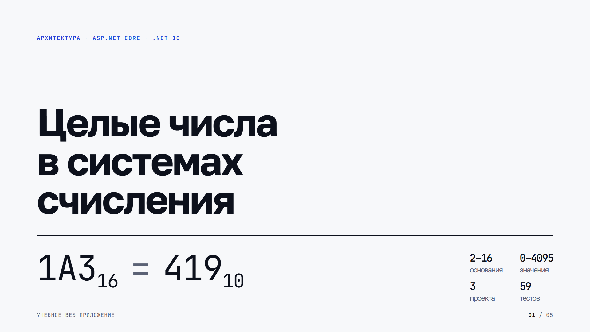
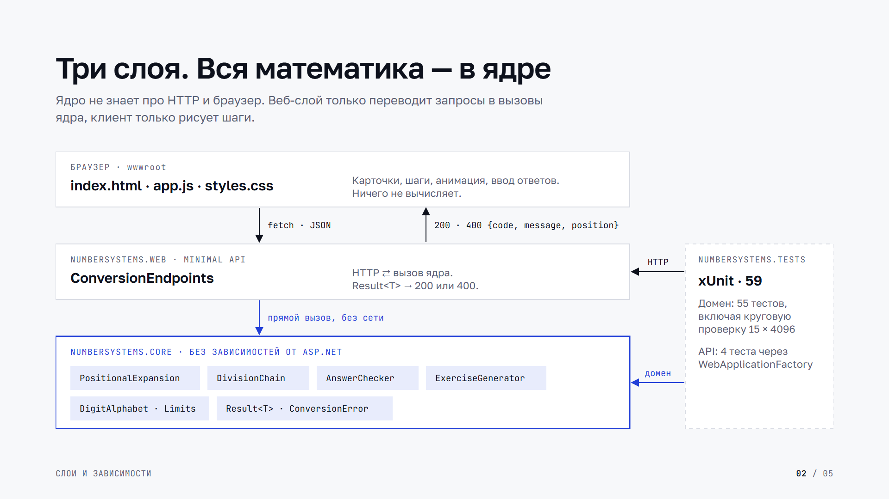
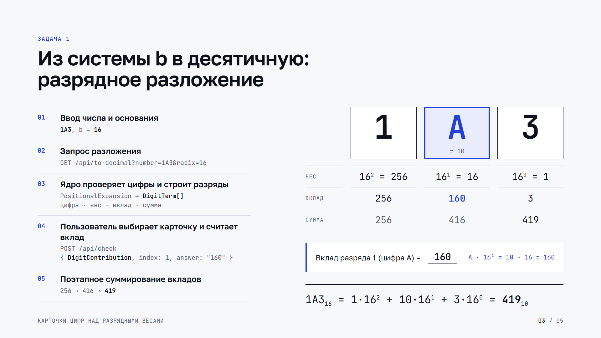
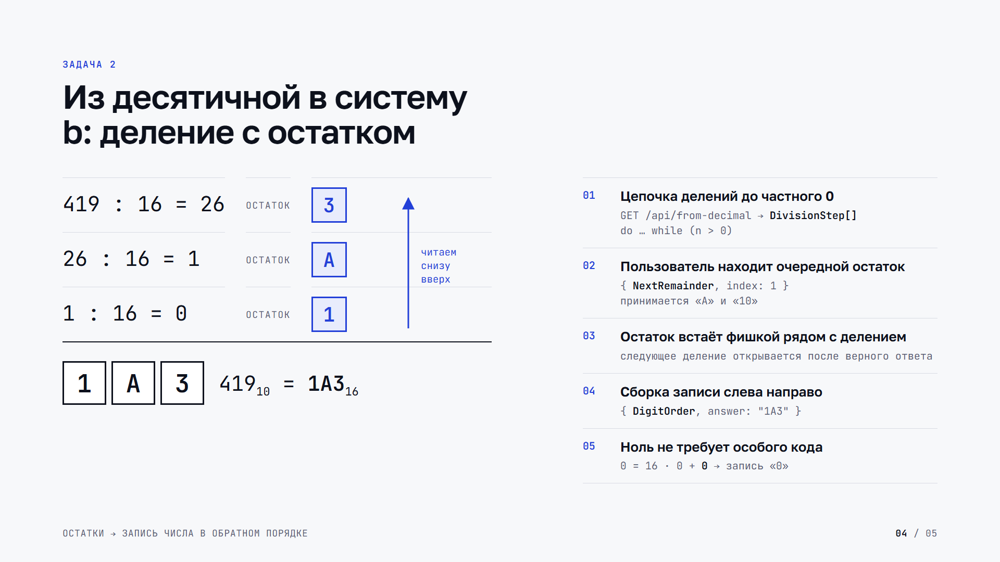
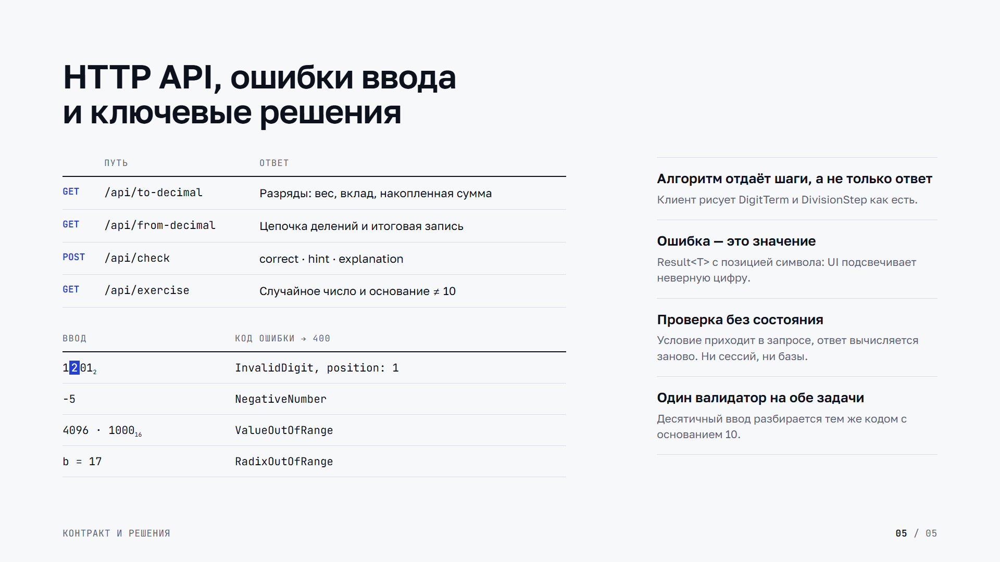

# Целые числа в системах счисления — архитектура

Учебное веб-приложение на ASP.NET Core (.NET 10). Два типа задач:

1. **В десятичную** — разрядное разложение: карточки цифр над весами `bᵏ`, поэтапное суммирование вкладов.
2. **Из десятичной** — последовательное деление с остатком: остатки появляются рядом с делениями, затем собираются в запись числа.

Границы: основания 2–16, значения 0–4095, не больше 12 цифр.

## Слайды

Пять слайдов 1920×1080: [PDF](docs/architecture/architecture.pdf), исходник [deck.html](docs/architecture/deck.html).
После правок в `deck.html` пересобрать PNG и PDF: `powershell -ExecutionPolicy Bypass -File docs/architecture/render.ps1`.







## Слои

```
┌────────────────────────── Браузер ──────────────────────────┐
│ wwwroot/index.html · styles.css · app.js                     │
│ Отрисовка шагов, анимация, сбор действий пользователя.       │
│ Никакой математики: всё считает и проверяет сервер.          │
└───────────────┬──────────────────────────────────────────────┘
                │ JSON (fetch)
┌───────────────▼──────────── NumberSystems.Web ───────────────┐
│ Program.cs              — хостинг, статика, DI, JSON-енумы   │
│ Api/ConversionEndpoints — Minimal API: HTTP ⇄ вызов ядра,    │
│                           Result<T> → 200 / 400              │
└───────────────┬──────────────────────────────────────────────┘
                │ прямые вызовы
┌───────────────▼──────────── NumberSystems.Core ──────────────┐
│ Limits, DigitAlphabet   — границы, цифры 0–F, проверка b     │
│ PositionalExpansion     — b → 10, список DigitTerm           │
│ DivisionChain           — 10 → b, список DivisionStep        │
│ Exercises/AnswerChecker — проверка ответов + подсказки       │
│ Exercises/ExerciseGenerator — случайные задачи               │
│ Result<T>, ConversionError — ошибки ввода без исключений     │
└──────────────────────────────────────────────────────────────┘
```

Ядро — чистая библиотека без зависимостей от ASP.NET: его можно подключить к Blazor, консоли или WPF без изменений.

## Ключевые решения

**Алгоритм возвращает шаги, а не только ответ.** `ToDecimal` отдаёт `DigitTerm(Position, Symbol, DigitValue, Weight, Contribution, RunningSum)` для каждого разряда — ровно то, что рисуется на карточке и в строке суммы. `FromDecimal` отдаёт `DivisionStep(Dividend, Divisor, Quotient, Remainder, RemainderSymbol)` для каждого деления и итоговую запись `Digits` (остатки в обратном порядке). Клиенту не нужно ничего пересчитывать.

**Ошибки ввода — значения, а не исключения.** `Result<T>` содержит либо результат, либо `ConversionError(Code, Message, Position)`. `Position` указывает на недопустимый символ, и UI подсвечивает его прямо в записи числа. Коды: `EmptyInput`, `TooManyDigits`, `NegativeNumber`, `InvalidDigit`, `RadixOutOfRange`, `ValueOutOfRange`, `IndexOutOfRange`.

**Один валидатор на оба направления.** Десятичный ввод для деления разбирается через `PositionalExpansion.ToDecimal(input, 10)`, поэтому «12a», «-5», «5000» и пустая строка обрабатываются одинаково в обеих задачах.

**Ноль — не особый случай в коде.** Цикл `do … while (n > 0)` даёт для нуля ровно одно деление `0 = b·0 + 0` и запись «0»; разложение «0» даёт одну карточку с вкладом 0.

**Проверка ответов без состояния.** Запрос `/api/check` несёт условие целиком (`kind, number, radix, index, answer`), сервер заново вычисляет правильный ответ. Нет сессий и хранилища, правила приёма ответов живут в C#: например, остаток 11 при основании 16 засчитывается и как «B», и как «11», регистр и пробелы не важны.

Компромисс: эндпоинты визуализации отдают полные шаги, так что ответ можно подсмотреть в DevTools. Для тренажёра это нормально; для контрольной нужно было бы выдавать задачу по `id` и хранить ответ на сервере.

## HTTP API

| Метод | Путь | Назначение |
|---|---|---|
| GET | `/api/to-decimal?number=1A3&radix=16` | `ExpansionResult`: разряды с весами, вкладами и накопленной суммой |
| GET | `/api/from-decimal?number=419&radix=16` | `DivisionResult`: цепочка делений и итоговая запись |
| POST | `/api/check` | `{kind, number, radix, index, answer}` → `{correct, expected, hint, explanation}` |
| GET | `/api/exercise?direction=ToDecimal\|FromDecimal` | Случайное число и основание (основание 10 исключено) |

Ошибка ввода → `400` с телом `{code, message, position}`.

`kind` для проверки:

| kind | Что ищет пользователь | `number` | `index` |
|---|---|---|---|
| `DigitContribution` | вклад выбранного разряда | запись в системе `radix` | номер разряда (справа, с 0) |
| `NextRemainder` | очередной остаток | десятичное число | номер деления |
| `DigitOrder` | порядок записи цифр | десятичное число | не используется |

## Сценарии в интерфейсе

**В десятичную.** Карточки цифр (для A–F под цифрой её значение), под ними вес `bᵏ` и его значение. Клик по карточке → поле «Вклад разряда k =» → проверка на сервере → при неверном ответе подсказка, по кнопке полное решение. «Следующий вклад» добавляет строку `d · bᵏ = вклад  сумма = …` и подсвечивает разряд; в конце итог `1A3₁₆ = 1·16² + 10·16¹ + 3·16⁰ = 419₁₀`.

**Из десятичной.** Строка деления `419 : 16 = 26  остаток [ ]`. Пользователь вводит остаток, после верного ответа на его месте появляется фишка, и открывается следующее деление. Когда частное стало 0, фишки становятся кликабельными: пользователь собирает запись слева направо, сервер проверяет порядок. «Показать» анимирует сборку от последнего остатка к первому и подписывает список «↑ читаем снизу вверх».

## Структура

```
NumberSystems.sln
src/NumberSystems.Core/           доменная логика (без зависимостей)
src/NumberSystems.Web/            ASP.NET Core Minimal API + wwwroot
tests/NumberSystems.Tests/        xUnit: ядро + интеграционные тесты API
```

## Запуск

```
dotnet run --project src/NumberSystems.Web --urls http://localhost:5080
dotnet test
```

## Тесты

- Разложение: примеры, регистр, ведущие нули, ноль, позиции недопустимых цифр, все коды ошибок.
- Деление: шаги для 419→16, ноль, **круговая проверка всех 0…4095 во всех основаниях 2…16**.
- Проверка ответов: вклад, остаток символом и числом, порядок, отсутствующий разряд или деление.
- API (`WebApplicationFactory`): коды 200/400, формат ошибки, енумы строками, отдача статики.

## Как расширять

- **Дробные числа или отрицательные** — новые методы в ядре, которые возвращают свои шаги; UI получает новую вкладку.
- **Перевод b₁ → b₂** — композиция `ToDecimal` и `FromDecimal`, отдельный эндпоинт, переиспользующий оба списка шагов.
- **Режим контрольной** — `IExerciseStore` (в памяти или EF Core): задача выдаётся по `id`, ответ не уходит клиенту.
- **UI на C# (Blazor)** — ядро подключается напрямую, HTTP-слой не нужен.
